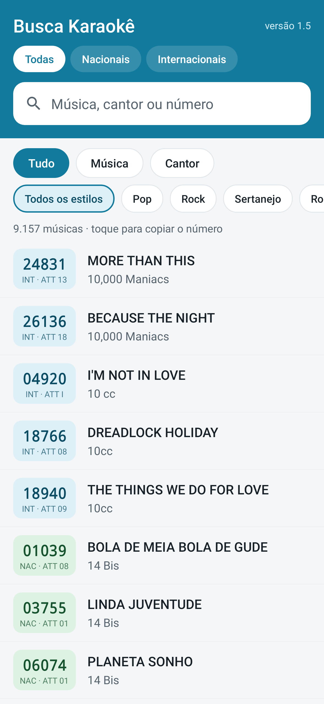
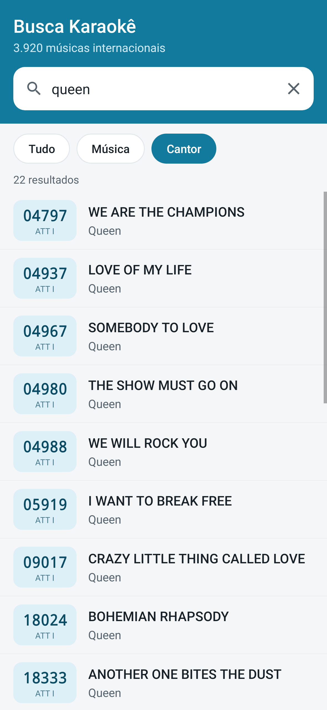
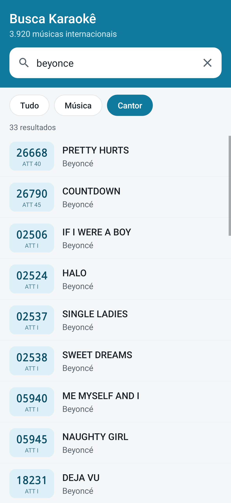

# Busca Karaokê

App Android para procurar músicas da **Lista Completa Internacional** (HD-OKÊ) pelo
**nome da música** ou pelo **nome do cantor** e ver o número para digitar no aparelho.

<p>
  
  
  
  
</p>

## Instalar

1. Baixe o arquivo [`apk/BuscaKaraoke.apk`](apk/BuscaKaraoke.apk) no celular.
2. Abra o arquivo. Se o Android pedir, permita **"instalar apps desconhecidos"** para o
   navegador ou gerenciador de arquivos.
3. Funciona sem internet, no Android 5.0 ou mais novo.

## Como usar

- Digite na caixa de busca. Os resultados aparecem enquanto você digita.
- Filtros: **Tudo** (música, cantor ou número), **Música** ou **Cantor**.
- Não precisa de acento: `beyonce` acha "Beyoncé", `cancao do mar` acha "CANÇÃO DO MAR".
  Com acento também funciona.
- Não importa maiúscula/minúscula ou apóstrofo: `dont trust me` encontra
  "DON'T TRUST ME", `acdc` encontra "AC/DC".
- Pode misturar música e cantor: `hello adele`. Se o filtro **Música** ou **Cantor** não
  achar nada, o app procura nos dois sozinho e avisa.
- Aceita pequenos erros de digitação: `bohemian rapsody`, `bom jovi`, `whitney huston`.
- Toque numa música para **copiar o número**.

## Atualizar a lista

A lista fica em `app/src/main/assets/musicas.tsv` (3.920 músicas extraídas do PDF).
Para gerar de novo a partir de um PDF novo:

```bash
pdftotext -layout LISTA_COMPLETA_INTERNACIONAL.pdf lista.txt
python3 tools/pdf_para_tsv.py lista.txt app/src/main/assets/musicas.tsv
./gradlew assembleRelease   # APK em app/build/outputs/apk/release/
```

Observação: no PDF original a música **26818 (Celeste)** não tem título; no app ela
aparece como "(sem título na lista)".

## Desenvolvimento

- Java puro, sem bibliotecas externas no app (APK de ~90 KB). `minSdk 21`, `targetSdk 35`.
- Testes (JUnit + Robolectric) cobrem a busca, a cópia do número e geram as capturas em `docs/`:
  `./gradlew testDebugUnitTest`
- O APK é assinado com `app/keystore/app.keystore` (senha `android`), uma chave simples
  guardada no repositório para que versões novas instalem por cima das antigas. Para
  publicar na Play Store, use uma chave própria e secreta.
