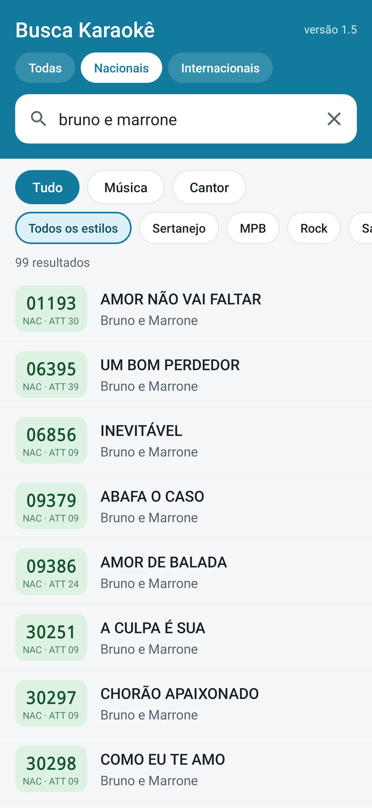
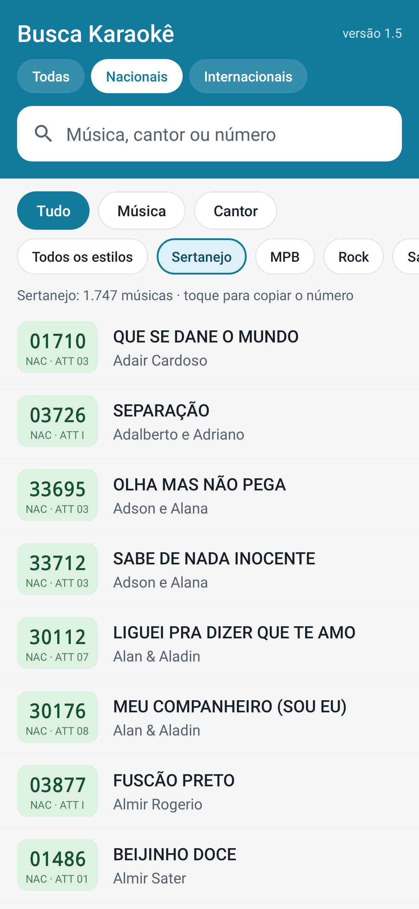
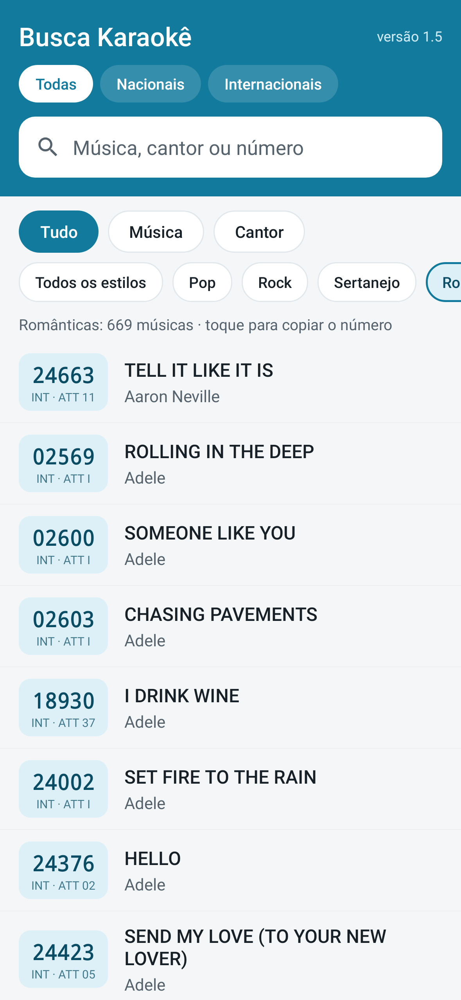
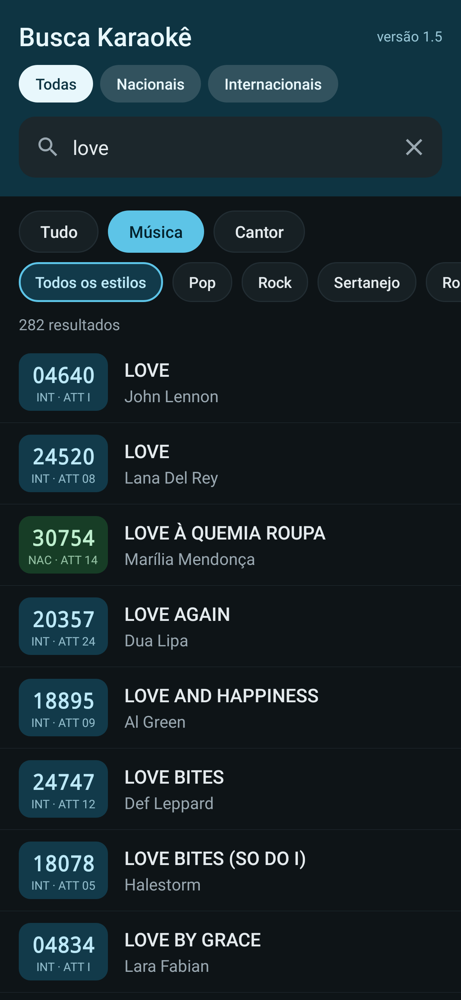

# Busca Karaokê

App Android para procurar músicas das listas de karaokê HD-OKÊ (**Nacional** e
**Internacional**, 9.157 músicas) pelo **nome da música** ou pelo **nome do cantor** e ver
o número para digitar no aparelho.

<p>
  
  
  
  
  
  
</p>

## Instalar

1. Baixe o arquivo [`apk/BuscaKaraoke.apk`](apk/BuscaKaraoke.apk) no celular.
2. Abra o arquivo. Se o Android pedir, permita **"instalar apps desconhecidos"** para o
   navegador ou gerenciador de arquivos.
3. Funciona sem internet, no Android 5.0 ou mais novo.

## Como usar

- No topo, escolha a lista: **Todas**, **Nacionais** ou **Internacionais**. Músicas
  nacionais têm a caixa do número verde e a marca "NAC"; internacionais, "INT". Se a
  busca não achar nada na lista escolhida, o app mostra o que achou na outra e avisa.
- Digite na caixa de busca. Os resultados aparecem enquanto você digita.
- Filtros: **Tudo** (música, cantor ou número), **Música** ou **Cantor**.
- Não precisa de acento: `beyonce` acha "Beyoncé", `cancao do mar` acha "CANÇÃO DO MAR".
  Com acento também funciona.
- Não importa maiúscula/minúscula ou apóstrofo: `dont trust me` encontra
  "DON'T TRUST ME", `acdc` encontra "AC/DC".
- Pode misturar música e cantor: `hello adele`. Se o filtro **Música** ou **Cantor** não
  achar nada, o app procura nos dois sozinho e avisa.
- Aceita pequenos erros de digitação: `bohemian rapsody`, `bom jovi`, `whitney huston`.
- Aceita nomes escritos "pelo som": `xakira`, `uitney huston`, `ed xiran`, `bionce`.
- Filtre por **estilo musical** na segunda fileira de botões (role para o lado):
  Sertanejo, Pop, Rock, MPB, Românticas, Samba e Pagode, Forró e Piseiro, Gospel, Axé,
  Brega e Arrocha, Funk, R&B e Soul, Dance, Rap e Hip-Hop, Latinas, Country, Reggae,
  Jazz e Blues, Filmes e Musicais, Infantil, Italianas e Europeias, K-pop. Os estilos
  aparecem do mais comum para o menos comum na lista escolhida.
  O estilo funciona junto com a busca (ex.: estilo Românticas + `love`). Se a música
  não for do estilo marcado, ela aparece mesmo assim, com o aviso "Nada em …".
- A versão instalada aparece no topo da tela.
- Toque numa música para **copiar o número**.

## Atualizar a lista

As listas ficam em `app/src/main/assets/`:

| Arquivo | Origem | Músicas |
|---|---|---|
| `internacional.tsv` | LISTA_COMPLETA_INTERNACIONAL.pdf (66 páginas) | 3.920 |
| `nacional.tsv` | LISTA_COMPLETA_NACIONAL.pdf (88 páginas) | 5.237 |

Para gerar de novo a partir de um PDF novo:

```bash
pdftotext -layout LISTA_COMPLETA_NACIONAL.pdf nacional.txt
python3 tools/pdf_para_tsv.py nacional.txt app/src/main/assets/nacional.tsv
python3 tools/conferir_estilos.py   # todo cantor novo precisa de estilo
./gradlew assembleRelease           # APK em app/build/outputs/apk/release/
```

Confira se o total bate com o PDF (páginas cheias têm 60 músicas).

### Estilos musicais

O PDF não traz o estilo das músicas. Ele foi definido **por cantor** no arquivo
`app/src/main/assets/estilos.txt` (uma linha por cantor: `Cantor | estilo,estilo`).
Colaborações ("X ft. Y", "X & Y", "X e Y") usam o estilo do primeiro cantor (ou da
primeira dupla: "Bruno e Marrone & Chitãozinho e Xororó" usa o de "Bruno e Marrone"). Estilos com menos
de 5 músicas não aparecem como filtro. Depois de mudar a lista ou os estilos, confira se
nenhum cantor ficou sem estilo:

```bash
python3 tools/conferir_estilos.py
```

Observação: no PDF original a música **26818 (Celeste)** não tem título; no app ela
aparece como "(sem título na lista)".

## Desenvolvimento

- Java puro, sem bibliotecas externas no app (APK de ~90 KB). `minSdk 21`, `targetSdk 35`.
- Testes (JUnit + Robolectric) cobrem a busca, a cópia do número e geram as capturas em `docs/`:
  `./gradlew testDebugUnitTest`
- O APK é assinado com `app/keystore/app.keystore` (senha `android`), uma chave simples
  guardada no repositório para que versões novas instalem por cima das antigas. Para
  publicar na Play Store, use uma chave própria e secreta.
